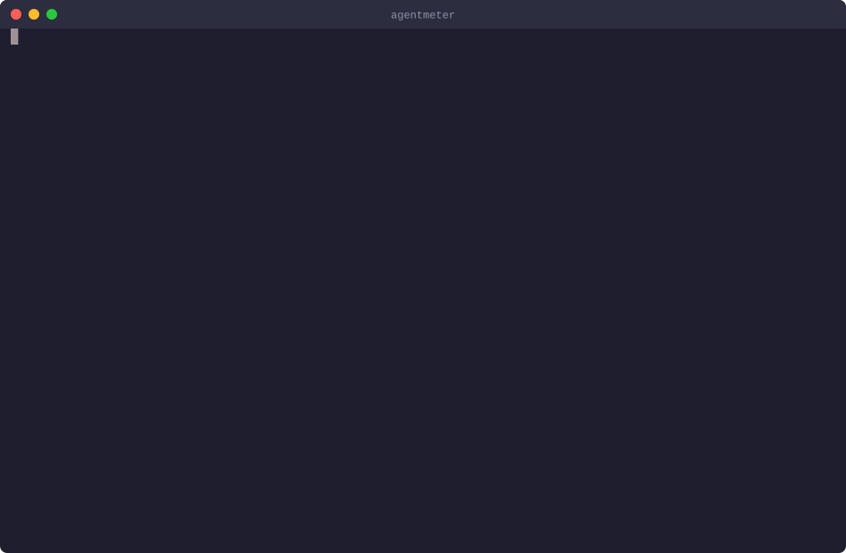

# agentmeter

Explains coding-agent usage. agentmeter reads the session logs that **Claude Code** already
writes to your disk, and the ones **Codex CLI** writes, and reports observations from your own
usage, each with the evidence behind it, how sure it is and one concrete thing to check next.

> **Status:** early development (0.x). Output, JSON shape and rule definitions may change
> between minor versions; the changelog lists every change.

<p align="center">
  
</p>

<p align="center"><sub>Recorded output of <code>agentmeter --findings --probe</code> on synthetic sample logs from <code>examples/demo-logs</code>.</sub></p>

## Install

```sh
cargo install agentmeter
```

Needs Rust 1.88 or newer. Prebuilt binaries for macOS (Apple silicon, Intel) and Linux (x86_64,
arm64, static) are on the [releases page](https://github.com/casoon/agentmeter/releases).

Official binaries come only from the GitHub releases of `casoon/agentmeter`, built there by the
release workflow, never on a developer machine. To verify a download by hand, check the hash and
the signed build provenance:

```sh
shasum -a 256 -c agentmeter-<version>-<target>.tar.gz.sha256
gh attestation verify agentmeter-<version>-<target>.tar.gz --repo casoon/agentmeter
```

The binaries are built with `cargo auditable`, so `cargo audit bin agentmeter` can check a
downloaded one for known vulnerabilities.

Run `agentmeter` in a terminal: it opens a menu with the summary,
sessions, projects, one row per rule and the data quality per source. `S` switches the source,
`P` the period, `/` searches.

```
agentmeter  Claude Code · Codex CLI · last 7 days

OVERVIEW
› Summary         claude 30,955 · codex 2,959 requests
  Sessions        claude 136 · codex 46
FINDINGS
  baseline-load   claude observed · codex observed
  cache-rebuild   claude observed · codex n/a
  compact-thrash  claude none · codex n/a
  …
```

(Shortened, figures from one author's logs. `none`: checked, nothing to report. `n/a`: the source cannot support the rule.)

## What it does

Existing tools add up tokens and cost. agentmeter looks at how usage came about:

- how large the first request of a session is, and how that changes over time
- how much of your input comes from very large contexts, next to the cache share
- large cache writes after pauses, with the cause marked *unknown* when the logs do not show it
- sessions that span many hours or days
- which sessions and projects account for the input

Each finding opens with a conclusion: **lever** (a setting or habit you control moves the
number; weigh it), **look at it** (the logs cannot decide; the evidence needs a look) or **fine**.
Bars show what the number is made of, and a block at the top shows what was read, how well, and
which rules could be measured.

High usage does not prove waste, and usage logs do not show the quality of a result. Every rule
therefore states what it measured, its denominator and sample size, known counter-examples and
what it does *not* conclude. "No findings" and "not enough data" are reported separately, and the
report lists data gaps: observed period, files without usage, unreadable entries, unknown models
and entry types.

```
READ
  ✓ logs      1,299 files, 855,776 lines from ~/.claude/projects
  ✓ probe     /context in 4 of 4 places; answered locally, no model request

FINDINGS   ? 3 to look at   ✓ 1 fine   ✓ 1 nothing found

? cache-rebuild                                      look at it · notice · observed · v1
  ⇒ 202 rebuilds (60.1 M) are in sub-agent files, which wrote 100 % of their caches with
    5 min while the main conversation wrote 100 % with 1 h; …

    pause over 1 h                 █████████████████·······  42.4 M  147 rebuilds
    5 min expired, main session    ························       0  0 rebuilds
    5 min expired, sub-agents      ████████████████████████  60.1 M  202 rebuilds

? baseline-load                                      look at it · notice · observed · v1
  ⇒ today's configuration is 34k of the median start 79k (43 %); 34k more is in every
    start (front end, project instructions, a short first prompt) and 11k varies per
    session; 146 of 146 starts came from claude-desktop, …

    median start, split            ██████████████▓▓▓▓▓▓▓▓▓▓▓▓▓▓░░░░     79k
```

(Shortened; figures from one author's logs. The full output is `agentmeter --findings --probe`.)

## Usage

```sh
agentmeter                     # on a terminal: menu; otherwise the summary of every source with logs
agentmeter --summary           # totals, days and compactions
agentmeter --sessions          # sessions by input
agentmeter --projects          # projects by input
agentmeter --findings          # rules with conclusion, measure, evidence and next step
agentmeter --probe             # also ask Claude Code what a session start holds (see below)
agentmeter --tool codex        # claude, codex or all (default)
agentmeter --since 7d          # 7d, 30d or a date such as 2026-10-01
agentmeter --project <name>    # one project
agentmeter --json              # the same data as JSON, one entry per source (docs/reference/json.md)
agentmeter --check data-quality # exit 1 if a source has unreadable data or none to analyse
```

It reads `~/.claude/projects` (or `$CLAUDE_CONFIG_DIR`) and `~/.codex/sessions` plus
`archived_sessions` (or `$CODEX_HOME`), including compressed rollouts. Rules that a source cannot
support, for example cache rebuilds without cache-write data, are reported as "not measurable". Colour is used only on a terminal and
not when `NO_COLOR` is set.

## Asking Claude Code: `--probe`

The logs show how large the first request of a session is, not what it is made of. `--probe` asks
Claude Code itself: it runs `claude -p /context --no-session-persistence --output-format json` in
an empty directory and in the three busiest projects of the period, and splits the median session
start into today's configuration (system prompt, tools, skills, memory files, MCP servers), the
rest of the smallest start and what varies per session. Tools loaded on demand are listed apart,
because they are not sent at the start.

`/context` is answered locally: no model request, no cost, no session file. Starting `claude`
does load the configuration of each directory, including its MCP servers and hooks, which is why
the probe only runs when asked for (`--probe`, or *Context probe* in the menu). It measures
today's configuration, not the one the period ran with, and it measures the command-line
`claude`: the report names the front end that wrote the sessions, since a desktop app or IDE adds
instructions and tools of its own.

## Privacy

Read-only, no network, no telemetry; `--probe` is the one exception that starts another program
(`claude`, see above). The log files contain prompt and tool text, so they are
read in full, but agentmeter extracts only usage metadata (token counts, timestamps, model,
session and project ids, compaction events). Prompt and tool text is not analysed, stored or
printed; evidence points to a file and an event id, never to text. With `--probe` the report also
shows what `/context` lists: category sizes, paths of memory files and names of MCP servers.

## Limits

- Subscription quotas are not stored locally, so remaining quota cannot be shown.
- The log formats are not official and change between versions; unknown fields and entries are
  counted and reported, not guessed.
- Thresholds are uncalibrated. Hints are never errors.
- Tokens are not comparable across vendors.

## Documentation

The project page is built from [`site/`](site/) and [`docs/`](docs/) and published at
<https://casoon.github.io/agentmeter/>.

## Development

```sh
cargo test --workspace
```

Fixtures are synthetic, one per log-format epoch. A test against your own logs runs only with
`AGENTMETER_REAL_LOGS=1`.

## License

MIT — see [LICENSE](LICENSE).
